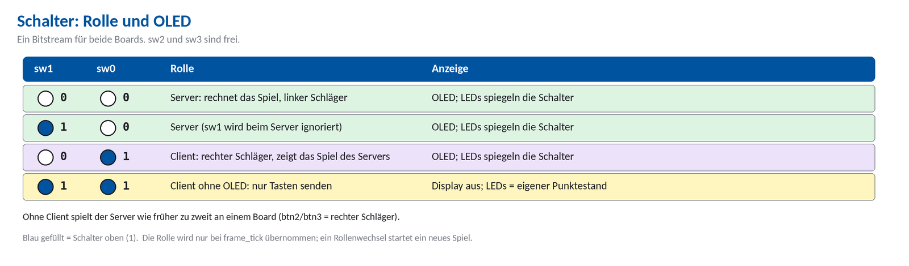
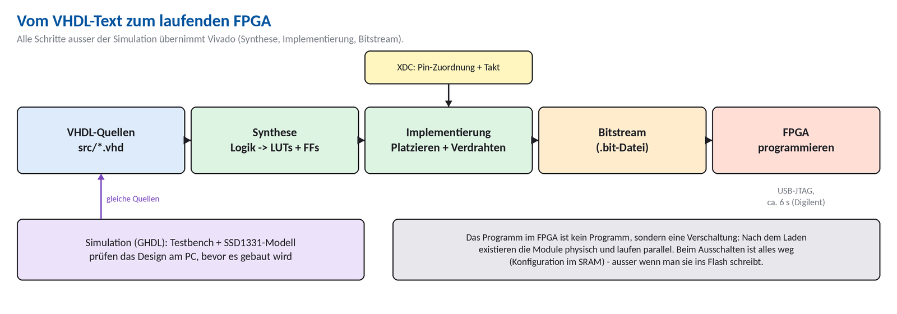
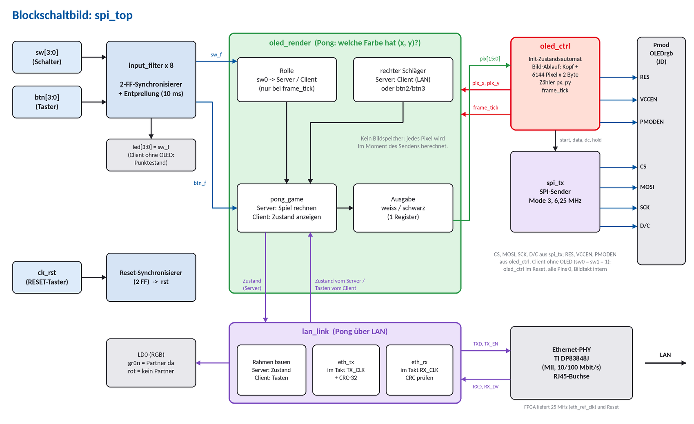
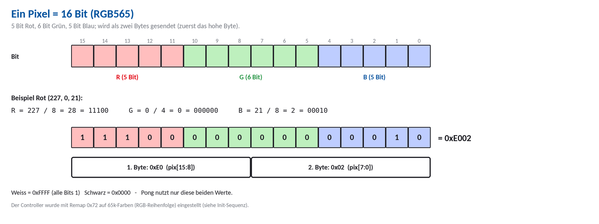
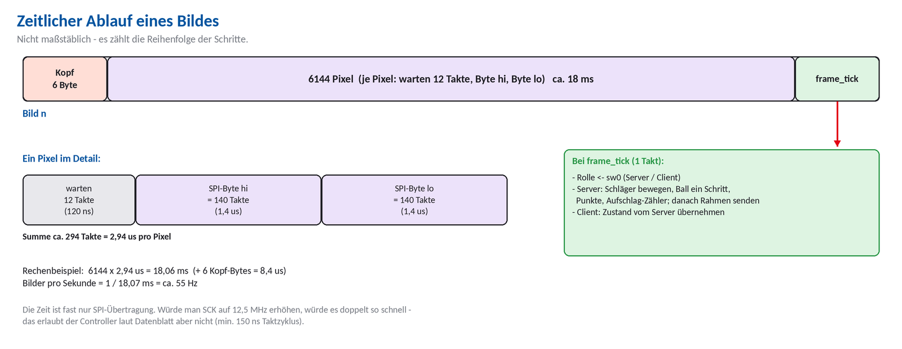
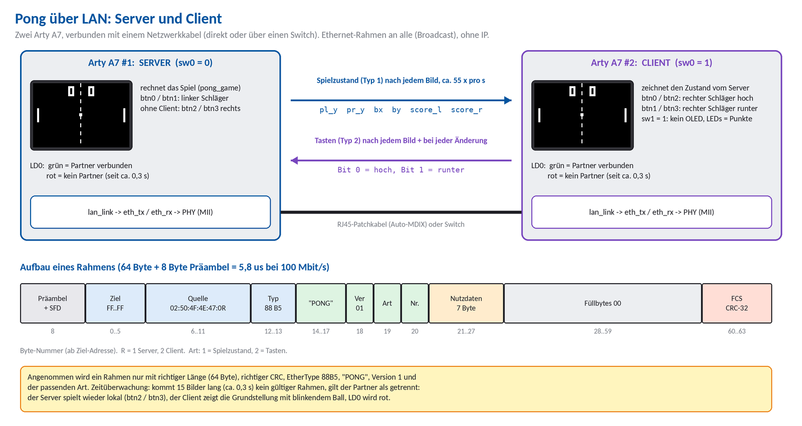
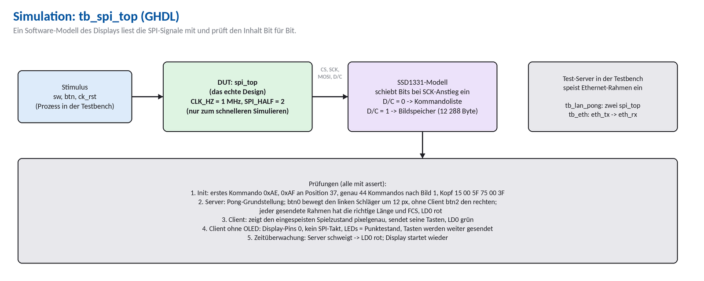

# Pong am Arty A7-35T: OLED per SPI, zwei Boards per LAN

*Pong 1 gegen 1 auf dem Pmod OLEDrgb - an einem Board oder mit zwei Arty A7 über LAN - Dokumentation für Einsteiger (Projekt prj_spi)*

Stand: 10.11.2026 | Bilder: `doc/img/` | PDF: `dokumentation.pdf` | Folien: `praesentation.pptx`

## Inhalt

- [Auf einen Blick](#auf-einen-blick)
- [1  Grundlagen: Was ist ein FPGA?](#1--grundlagen-was-ist-ein-fpga)
- [2  Die Hardware](#2--die-hardware)
- [3  Der Gesamtaufbau](#3--der-gesamtaufbau)
- [4  SPI: wie Daten zum Display kommen](#4--spi-wie-daten-zum-display-kommen)
- [5  Das Display ansteuern](#5--das-display-ansteuern)
- [6  Wie ein Bild entsteht](#6--wie-ein-bild-entsteht)
- [7  Pong](#7--pong)
- [8  Pong über LAN: zwei Arty](#8--pong-über-lan-zwei-arty)
- [9  Eingänge und Reset](#9--eingänge-und-reset)
- [10  Simulation und Tests](#10--simulation-und-tests)
- [11  Bauen, Programmieren, Fehlersuche](#11--bauen-programmieren-fehlersuche)
- [12  Erweiterungen und Übungen](#12--erweiterungen-und-übungen)
- [13  Glossar](#13--glossar)
- [14  Quellen](#14--quellen)

## Auf einen Blick

Dieses Projekt ist ein **Pong-Spiel** auf einem **Pmod OLEDrgb** (kleines Farbdisplay, 96 x 64 Pixel) am **Arty A7-35T** (Pmod-Buchse **JD**). Zwei Spieler spielen entweder an **einem Board** oder an **zwei Boards, die per LAN verbunden** sind. Alles - Spiel, Display-Ansteuerung und Ethernet - ist als Schaltung in **VHDL** beschrieben; es läuft kein Prozessor und kein Programm. Beide Boards bekommen **denselben Bitstream**, die Rolle wählt ein Schalter.

| Schalter | Bedeutung |
| --- | --- |
| **sw0** unten | **Server**: rechnet das Spiel, linker Schläger mit btn0/btn1. Ohne Client spielt man wie früher zu zweit an einem Board (btn2/btn3 = rechter Schläger). |
| **sw0** oben | **Client**: zweiter Arty am LAN, rechter Schläger mit btn0/btn2 (hoch) und btn1/btn3 (runter), zeigt das Spiel des Servers |
| **sw1** oben (nur Client) | **kein OLED** am Client: Display aus, die LEDs LD4 ... LD7 zeigen den eigenen Punktestand; beide schauen auf das Display des Servers |
| sw2, sw3 | frei |



*Abbildung 1: Schalter: Rolle und OLED*

### Stand des Projekts

- **Simulation (GHDL):** alle Tests bestanden - Initialisierung, Bildformat, Pong-Schläger, Server und Client (mit und ohne OLED, `tb_spi_top`), Ethernet-Sender/-Empfänger (`tb_eth`) und zwei komplette Boards, die über ein LAN-Modell Pong spielen (`tb_lan_pong`).
- **Hardware:** Die Display-Ansteuerung und Pong liefen laut Projektteam auf dem Arty A7 (damals noch mit Logo-Bildern, die inzwischen entfernt sind). Die LAN-Erweiterung (Kapitel 8) ist simuliert und mit einem freien Synthese-Werkzeug (GHDL + Yosys) für Artix-7 übersetzt, aber **noch nicht auf echten Boards erprobt**. Vivado-Build und Timing-Berichte sind nicht Teil dieser Dokumentation.
- **Dokumentierter Code:** `src/*.vhd`, `sim/*.vhd`, `constraints/arty_a7_35_oled.xdc`.

### In fünf Schritten starten

1. Pmod OLEDrgb **bei ausgeschaltetem Board** bis zum Anschlag in **JD** stecken (Abschnitt 2.4).
2. `scripts/create_project.tcl` in Vivado ausführen (erzeugt das Projekt `spi_oled`).
3. In Vivado **Generate Bitstream** und danach im Hardware Manager **Program Device** (USB-Kabel).
4. Alle Schalter unten: das Board ist **Server**, das Spiel läuft sofort.
5. **btn0/btn1** bewegen den linken, **btn2/btn3** den rechten Schläger. Mit zwei Arty über LAN (zweites Board: sw0 oben): Kapitel 8.

## 1  Grundlagen: Was ist ein FPGA?

Dieses Kapitel erklärt alles, was du brauchst, um den Rest zu verstehen - auch wenn du noch nie einen FPGA programmiert hast.

### 1.1  Digital heißt: nur 0 und 1

In digitaler Elektronik hat jede Leitung nur zwei Zustände: **0** (Spannung nahe 0 V) oder **1** (beim Arty A7 etwa 3,3 V). Alles Komplizierte - Zahlen, Bilder, Text - wird aus vielen solcher Leitungen zusammengesetzt. Ein Farbpixel zum Beispiel besteht in diesem Projekt aus 16 Leitungen (16 Bit).

### 1.2  FPGA und Mikrocontroller im Vergleich

Ein **Mikrocontroller** (z. B. Arduino) hat eine feste Schaltung (den Prozessor), der man ein Programm gibt. Es wird Befehl für Befehl nacheinander abgearbeitet. Ein **FPGA** (Field Programmable Gate Array) ist dagegen ein Chip voller kleiner, frei verschaltbarer Bausteine. Man beschreibt, **wie sie verbunden sein sollen**; danach existiert diese Schaltung wirklich und alle Teile arbeiten **gleichzeitig**.

|  | Mikrocontroller | FPGA |
| --- | --- | --- |
| Was man schreibt | Programm (C, Python ...) | Schaltungsbeschreibung (VHDL, Verilog) |
| Ablauf | Befehle nacheinander | alle Bausteine gleichzeitig, im Takt |
| Zeitverhalten | schwankt (Interrupts, Compiler) | exakt: jeder Schritt = 1 Taktperiode (hier 10 ns) |
| Gut für | Steuerungen, Software | schnelle parallele Signalverarbeitung, eigene Schnittstellen |
| Beispiel hier | - | SPI-Sender, Bildgenerator und Spiel laufen parallel |

### 1.3  Die zwei wichtigsten Bausteine: LUT und Flip-Flop

**LUT (Look-Up Table):** ein winziger Speicher, der jede Logikfunktion kann. Die Eingänge sind die Adresse, im Speicher steht das Ergebnis. Eine UND-Verknüpfung ist zum Beispiel eine Tabelle mit vier Zeilen. Ein Artix-7 hat 6-Eingangs-LUTs; der Arty A7-35T enthält laut Digilent 5 200 Slices zu je vier LUTs und acht Flip-Flops [1].

**Flip-Flop (FF):** speichert **ein Bit**. Es übernimmt seinen Eingang D nur bei der **steigenden Taktflanke** und hält den Wert danach bis zur nächsten Flanke. Mehrere Flip-Flops nebeneinander nennt man **Register**.


*Abbildung 2: LUT, Flip-Flop und synchrone Schaltung*

### 1.4  Der Takt: alles geschieht gleichzeitig

Der Arty A7 hat einen Quarzoszillator mit **100 MHz** (Pin E3) [1]. Eine Periode dauert also **10 ns**. Bei jeder steigenden Flanke übernehmen alle Flip-Flops im ganzen Chip gleichzeitig das Ergebnis der Logik, die vor ihnen liegt. Zwischen zwei Flanken rechnet die Logik; sie muss in 10 ns fertig werden, sonst gibt es Timing-Fehler. Diese Bauweise heißt **synchron** und ist die wichtigste Regel im FPGA-Entwurf.

> **Hinweis:** Merksatz: **Register - Logik - Register.** Jede Berechnung geht von einem Register zum nächsten. Je kürzer die Logik dazwischen, desto schneller darf der Takt sein. Deshalb gibt es in diesem Projekt eine **Pipeline** (Abschnitt 6.6): sie zerlegt einen langen Rechenweg in kurze Stücke.

### 1.5  VHDL: eine Schaltung beschreiben

VHDL ist eine **Beschreibungssprache**, keine Programmiersprache. Eine Zeile bedeutet nicht "tu das jetzt", sondern "hier gibt es diese Schaltung". Jedes Modul hat zwei Teile:

- **entity** - die Schnittstelle (Name, Ein- und Ausgänge, wie die Anschlüsse eines Bausteins).
- **architecture** - der Inhalt (Signale, Prozesse, Verbindungen).

Ein **process (clk)** mit `if rising_edge(clk)` beschreibt Register: Alles darin wird bei jeder steigenden Taktflanke ausgeführt. Als Beispiel der Entprell-Filter des Projekts (Modul `input_filter`):

```vhdl
process (clk)
begin
    if rising_edge(clk) then
        sync <= sync(0) & d;               -- 2-Flip-Flop-Kette (Eingang einsynchronisieren)
        if rst = '1' then
            stable <= '0';
            cnt    <= 0;
        elsif sync(1) = stable then        -- nichts hat sich geändert
            cnt <= 0;
        elsif cnt = DEBOUNCE_CYCLES then   -- 10 ms lang anders -> übernehmen
            cnt    <= 0;
            stable <= sync(1);
        else
            cnt <= cnt + 1;                -- zählen, wie lange der neue Pegel anliegt
        end if;
    end if;
end process;
```

| VHDL | Bedeutung |
| --- | --- |
| `<=` | Signalzuweisung: der neue Wert gilt **ab der nächsten Taktflanke** |
| `:=` | Variable: sofortige Zuweisung nur innerhalb eines Prozesses (Rechenzwischenwerte) |
| `&` | Zusammenhängen von Bitfolgen: `sync(0) & d` schiebt `d` hinten an |
| `x"AE"` | Hexadezimalzahl, hier 1010 1110 |
| `(others => '0')` | alle Bits auf 0 |
| `7 downto 0` | ein 8-Bit-Vektor, Bit 7 ist das höchstwertige (links) |
| `std_logic`, `unsigned` | Bit bzw. vorzeichenlose Zahl als Bitvektor |
| `generic` | Parameter eines Moduls (z. B. Taktfrequenz, `HALF` beim SPI) |

### 1.6  Zustandsautomaten (FSM)

Viele Abläufe bestehen aus Schritten, die nacheinander kommen - wie eine **Ampel**: rot, rot-gelb, grün, gelb. Ein Zustandsautomat (Finite State Machine) merkt sich in einem Register, in welchem Schritt er ist (`state`), und entscheidet bei jedem Takt, ob er bleibt oder weitergeht. In VHDL schreibt man das als `case state is ...`. Dieses Projekt hat drei Automaten: den SPI-Sender (`spi_tx`), die Display-Steuerung (`oled_ctrl`) und - als Spielablauf - Pong.

### 1.7  Pipeline, Zähler, Schieberegister

- **Zähler:** ein Register, das bei jedem Takt um 1 größer wird. Damit misst man Zeit ("warte 20 ms" = 2 000 000 Takte zählen).
- **Schieberegister:** eine Kette von Flip-Flops, in der die Bits pro Takt eine Stelle weiterrutschen. Der SPI-Sender schiebt so ein Byte Bit für Bit nach draußen.
- **Pipeline:** mehrere Register hintereinander mit wenig Logik dazwischen. Jede Stufe erledigt einen Teil; dadurch ist der Takt hoch möglich.

### 1.8  Vom Text zum laufenden FPGA



*Abbildung 3: Werkzeugkette: Quellen, Simulation, Synthese, Implementierung, Bitstream*

- **Simulation:** das Design läuft am PC; eine **Testbench** legt Eingangssignale an und prüft die Ausgänge mit `assert`. Hier mit **GHDL**. Fehler werden so gefunden, ohne dass Hardware nötig ist.
- **Synthese:** Vivado macht aus der Beschreibung LUTs und Flip-Flops.
- **Implementierung:** Vivado legt fest, welche LUT wo sitzt und wie sie verdrahtet werden, und weist den Pins die Namen aus der **XDC-Datei** zu.
- **Bitstream:** die fertige Konfigurationsdatei (`.bit`). Beim Arty A7-35T ist sie rund 17,5 Mbit groß; das Laden über USB-JTAG dauert laut Digilent etwa 6 Sekunden [1].
- **Flüchtig:** Der FPGA vergisst die Schaltung beim Ausschalten (SRAM-Konfiguration). Soll sie bleiben, schreibt man sie in den Flash [1].

### 1.9  Fünf Regeln, die jeder Anfänger kennen sollte

1. **Alles Getaktete hängt an einem Takt.** Hier: `CLK100MHZ`.
2. **Eingänge von außen immer einsynchronisieren** (2 Flip-Flops), sonst können Zufallswerte entstehen (Metastabilität).
3. **Mechanische Taster prellen** - mit einem Filter entprellen (Kapitel 9).
4. **Zeit = Takte zählen.** Es gibt kein `sleep()`.
5. **Erst simulieren, dann bauen.** Ein Fehler im Simulator ist in Sekunden gefunden, auf der Hardware oft nie.

## 2  Die Hardware

### 2.1  Das Board: Arty A7-35T

| Merkmal | Wert (Quelle [1]) |
| --- | --- |
| FPGA | Xilinx Artix-7 **XC7A35TICSG324-1L** |
| Takt | ein 100-MHz-Quarzoszillator an Pin **E3** |
| Bedienelemente | 4 Schiebeschalter, 4 Taster, 1 RESET-Taster, 4 LEDs, 4 RGB-LEDs |
| Erweiterung | 4 Pmod-Buchsen (JA, JB, JC, JD), Arduino-Shield-Anschluss |
| Netzwerk | Ethernet 10/100 Mbit/s: PHY **TI DP83848J** (MII) an der RJ45-Buchse; den 25-MHz-Takt des PHY liefert der FPGA |
| Programmieren | USB-JTAG (Micro-USB), Quad-SPI-Flash 16 MB |
| Spannungen | Pmod-Pins arbeiten mit 3,3 V; nie über 3,4 V treiben |

### 2.2  Die Pmod-Buchse JD

Ein Pmod-Anschluss ist eine Buchse mit 2 x 6 Kontakten im Abstand von 2,54 mm. Von den zwölf Kontakten sind **zwei Masse** (Pin 5 und 11), **zwei 3,3-V-Versorgung** (Pin 6 und 12) und **acht Signale** [1]. Die VCC- und GND-Pins können laut Digilent bis zu 1 A liefern, solange das Board insgesamt nicht überlastet wird [1].

**JD** ist ein **Standard-Pmod**: Die Signalleitungen laufen über **200-Ohm-Schutzwiderstände**. Das schützt vor Kurzschlüssen und begrenzt die maximale Schaltgeschwindigkeit - für SPI mit 6,25 MHz ist das unkritisch. JB und JC sind dagegen High-Speed-Pmods ohne Schutzwiderstände [1].

### 2.3  Das Display: Pmod OLEDrgb

- Anzeige mit **96 x 64 Pixeln**, jeder Pixel mit **16 Bit Farbe** (RGB 5-6-5) [2].
- Steuerchip: **SSD1331** von Solomon Systech [2].
- Schnittstelle: **SPI** (nur Schreiben, es kommt nichts zurück) [2].
- Versorgung 2,7 ... 3,5 V, empfohlen 3,3 V [2].
- Stromaufnahme bis ca. **75,5 mA**, wenn alle Pixel weiß und maximal hell sind [2] - deshalb bleibt das Display im Projekt moderat eingestellt.
- Zwei Leitungen schalten die Versorgung: **PMODEN** (Logik) und **VCCEN** (hohe Panelspannung). Sind beide aus, braucht das Modul etwa 200 nA [2].

### 2.4  Anschluss und Prüfung: GND mit GND, VCC mit VCC

Das Modul passt **1:1** auf JD: Pin 1 des Moduls ist Pin 1 von JD usw. Dabei liegen GND-Pins auf GND und VCC-Pins auf VCC automatisch richtig, **wenn der Stecker direkt und nicht versetzt eingesteckt ist**.


*Abbildung 4: Pin-Belegung des Pmod OLEDrgb und Zuordnung zu JD / Port-Namen*

#### So prüfst du den Anschluss

1. **Sichtprüfung:** Das Modul sitzt mit allen 12 Kontakten in der Buchse, nicht um eine Reihe oder um Pins verschoben. Obere Reihe = Pin 1 bis 6, untere Reihe = Pin 7 bis 12.
2. **Bei Kabelverbindung:** Pin 5 **und** 11 des Moduls auf GND, Pin 6 **und** 12 auf 3V3 (nicht umgekehrt!). Die Signalpins CS, MOSI, SCK, D/C, RES, VCCEN, PMODEN sind nicht austauschbar, weil die XDC-Datei sie auf feste FPGA-Pins legt. Pin 3 bleibt frei.
3. **Messen (Board an, Modul gesteckt):** Zwischen Pin 6 und Pin 5 des Moduls müssen etwa **3,3 V** liegen. Mit dem Durchgangsprüfer (Board aus): Pin 5 und Pin 11 sind miteinander verbunden, Pin 6 und Pin 12 ebenfalls, und zwischen Pin 5 und Pin 6 ist **kein** Durchgang (sonst Kurzschluss).
4. **Nie 5 V anlegen.** Die Pmod-Pins vertragen höchstens 3,4 V [1].

> **Achtung:** Stecke Module nur bei **ausgeschaltetem Board** um. Falsch herum gesteckte Versorgungspins können das Display zerstören.

### 2.5  Schalter, Taster, LEDs auf dem Board

| Bauteil | Port im Design | FPGA-Pin | Verhalten (nach [1]) |
| --- | --- | --- | --- |
| Takt | CLK100MHZ | E3 | 100 MHz |
| RESET-Taster | ck_rst | C2 | **aktiv low**: im Ruhezustand 1, gedrückt 0 |
| sw0 ... sw3 | sw[0] ... sw[3] | A8, C11, C10, A10 | Schiebeschalter: oben = 1, unten = 0 |
| btn0 ... btn3 | btn[0] ... btn[3] | D9, C9, B9, B8 | Taster: Ruhezustand 0, gedrückt 1 |
| LED0 ... LED3 (LD4 ... LD7) | led[0] ... led[3] | H5, J5, T9, T10 | 1 = LED an: spiegeln die Schalter; beim Client ohne OLED der eigene Punktestand (binär) |
| RGB-LED LD0 | led0_r, led0_g | G6, F6 | LAN-Status: grün = Partner verbunden, rot = kein Partner (gedimmt) |

## 3  Der Gesamtaufbau



*Abbildung 5: Blockschaltbild des Top-Moduls spi_top*

Der Datenfluss in einem Satz: **`oled_render` berechnet zu jedem Pixel (x, y) die Farbe des Pong-Bildes, `oled_ctrl` fragt es Pixel für Pixel ab und schickt jedes Pixel über `spi_tx` an das Display.** Für Pong über LAN tauscht `lan_link` zusätzlich Spielzustand und Tasten mit dem zweiten Arty aus (Kapitel 8).

### 3.1  Die Module

| Modul (Datei) | Aufgabe |
| --- | --- |
| `spi_top` | Top-Modul: verbindet alles, synchronisiert den Reset, erzeugt acht Entprell-Filter, steuert die LEDs, schaltet beim Client ohne OLED das Display ab und erzeugt dann den Bildtakt selbst |
| `input_filter` | 2-Flip-Flop-Synchronisierer + Entprellung (10 ms) für Schalter und Taster |
| `oled_render` | Pixelgenerator: übernimmt die Rolle (sw0), schaltet den rechten Schläger zwischen Client und btn2/btn3 um und liefert zu (x, y) Weiß oder Schwarz |
| `pong_game` | Spiellogik und Zeichnen von Pong; als Client nur Zeichnen des empfangenen Zustands |
| `pong_pkg` | Record `pong_state_t`: der sichtbare Spielzustand, der über das LAN geht |
| `lan_link` | LAN für Pong: Takt und Reset für den PHY, Rahmen bauen und prüfen, Zeitüberwachung |
| `eth_tx`, `eth_rx` | Ethernet-Sender/-Empfänger an der MII-Schnittstelle des PHY, mit CRC-32 |
| `eth_pkg` | Byte-Feld-Typ und CRC-32-Funktion |
| `oled_ctrl` | Ablaufsteuerung: Einschalten, Initialisieren, endlos Bilder senden; zählt x/y |
| `spi_tx` | SPI-Sender: schickt ein Byte seriell an das Display |
| `tb_spi_top` | Testbench mit Display-Modell |
| `tb_eth`, `tb_lan_pong` | Testbenches für Ethernet und für zwei Boards über LAN (mit `ssd1331_model`) |

### 3.2  Das Top-Modul im Detail

Im Top-Modul stecken vier Dinge. **Erstens** der Reset: Der RESET-Taster ist aktiv low, er wird invertiert und durch zwei Flip-Flops geführt (`rst_sync`), damit er mit dem Takt synchron ist. **Zweitens** acht `input_filter` (vier Schalter, vier Taster) per `generate`-Schleife. **Drittens** die Verbindung der Module: `oled_render` liefert `pix` an `oled_ctrl`, und `oled_ctrl` liefert `pix_x`, `pix_y` und `frame_tick` zurück. **Viertens** `lan_link` mit den Ethernet-Pins und die Status-LED LD0. Dazu kommt die Umschaltung für den Client ohne OLED (Abschnitt 6.2).

| Parameter (generic) | Standard | Bedeutung |
| --- | --- | --- |
| `CLK_HZ` | 100 000 000 | Taktfrequenz; daraus folgen die 10 ms Entprellzeit und die Mikrosekunden-Zeiten |
| `SPI_HALF` | 8 | Takte pro halber SCK-Periode: SCK = 100 MHz / (2 x 8) = 6,25 MHz |
| `PIPE_WAIT` (oled_ctrl) | 12 | Takte Wartezeit, bis das Pixel berechnet ist (es braucht 3) |
| `FRAME_HZ` | 55 | Bildrate des internen Zählers, wenn der Client ohne OLED läuft (so schnell wie das Display) |
| `NET_TIMEOUT` | 15 | so viele Bilder (ca. 0,3 s) ohne gültigen Rahmen, dann gilt der LAN-Partner als getrennt |

## 4  SPI: wie Daten zum Display kommen

### 4.1  Die Idee

**SPI** (Serial Peripheral Interface) ist eine einfache serielle Schnittstelle: Statt 8 Leitungen für ein Byte nutzt man **eine** Datenleitung und schickt die Bits nacheinander. Ein Taktsignal sagt, wann ein Bit gültig ist. Unser Display ist ein **Slave**; der FPGA ist der **Master** und bestimmt den Takt.

| Leitung | Richtung | Bedeutung |
| --- | --- | --- |
| **SCK** | FPGA -> Display | Takt: jede Flanke gehört zu einem Bit |
| **MOSI** | FPGA -> Display | Master Out, Slave In: die Datenbits |
| **CS** (CS_N) | FPGA -> Display | Chip Select, **aktiv low**: nur wenn 0, hört das Display zu |
| **D/C** | FPGA -> Display | Zusatzleitung des SSD1331: 0 = Byte ist ein **Kommando**, 1 = Byte ist **Pixeldaten** |
| (MISO) | - | gibt es nicht: das Display kann nur empfangen [2] |

### 4.2  Mode 3: wann ist ein Bit gültig?

Das Display arbeitet in **SPI-Mode 3**: Der Takt SCK **ruht auf 1**. Der Sender legt ein neues Bit bei der **fallenden** Flanke auf MOSI; das Display liest es bei der **steigenden** Flanke. Die kürzeste erlaubte Taktperiode ist **150 ns** [2]; das Projekt verwendet 160 ns (6,25 MHz).


*Abbildung 6: Ein Byte (0xAE) über SPI Mode 3*

Ablauf für das Byte **0xAE = 1010 1110**: CS geht auf 0. Nach einem kurzen Vorlauf (80 ns) fällt SCK, und das erste Bit (1) liegt an MOSI. Nach 80 ns steigt SCK - das Display übernimmt die 1. Nach weiteren 80 ns fällt SCK wieder, das nächste Bit (0) wird angelegt, und so weiter. Nach acht Takten ist das Byte übertragen; CS geht wieder auf 1 (bei Pixeldaten bleibt es auf 0).

### 4.3  Der SPI-Sender `spi_tx`


*Abbildung 7: Zustandsautomat von spi_tx*

| Zustand | Was passiert |
| --- | --- |
| `S_IDLE` | wartet. Kommt `start = 1`, werden `cs_n <- 0`, `dc <- dc_in`, das Schieberegister `sh <- data` gesetzt |
| `S_LEAD` | wartet `HALF` Takte (CS und D/C stabil), dann `sck <- 0` und das erste Bit `mosi <- sh(7)` |
| `S_LOW` | SCK bleibt `HALF` Takte auf 0, dann `sck <- 1` (steigende Flanke) |
| `S_HIGH` | SCK bleibt `HALF` Takte auf 1; danach entweder nächstes Bit (`sck <- 0`, `mosi <- sh(6)`, schieben) oder - beim 8. Bit - weiter zu `S_TRAIL` |
| `S_TRAIL` | Ist `hold = 0`, geht CS auf 1. `done` meldet **einen Takt lang** "Byte fertig" |

```vhdl
when S_LOW =>
    if tmr = HALF - 1 then
        tmr   <= 0;
        sck   <= '1';                 -- steigende Flanke: Display liest das Bit
        state <= S_HIGH;
    else
        tmr <= tmr + 1;
    end if;

when S_HIGH =>
    if tmr = HALF - 1 then
        tmr <= 0;
        if bits = 7 then
            state <= S_TRAIL;         -- alle 8 Bits gesendet
        else
            sck   <= '0';             -- fallende Flanke: nächstes Bit anlegen
            mosi  <= sh(6);
            sh    <= sh(6 downto 0) & '0';
            bits  <= bits + 1;
            state <= S_LOW;
        end if;
    else
        tmr <= tmr + 1;
    end if;
```

Der Eingang `hold` ist wichtig für die Geschwindigkeit: Kommandos werden mit `hold = 0` gesendet (CS geht nach jedem Byte hoch). Beim Pixelstrom ist `hold = 1`, CS bleibt für das ganze Bild auf 0 - bis auf das allerletzte Byte.

### 4.4  Zahlen

| Größe | Wert |
| --- | --- |
| Takt des FPGA | 100 MHz (10 ns) |
| SCK | 100 MHz / 16 = **6,25 MHz** (160 ns Periode; erlaubt: min. 150 ns [2]) |
| Übertragung eines Bytes | 8 x 160 ns = 1,28 µs |
| Ein Byte inklusive Vorlauf und Handshake | ca. 140 Takte = 1,4 µs |
| Ein Pixel (2 Byte + 12 Takte Wartezeit) | ca. 294 Takte = 2,94 µs |

## 5  Das Display ansteuern

### 5.1  Der Controller SSD1331

Hinter dem Glas sitzt der Chip SSD1331. Er hat einen eigenen **Bildspeicher** (96 x 64 Pixel). Was dort steht, zeigt er dauerhaft an - der FPGA muss das Bild nicht ständig wiederholen, sondern nur dann schreiben, wenn sich etwas ändert. In diesem Projekt wird trotzdem **immer wieder das ganze Bild** geschrieben, weil Pong und die Drehung ständig neue Bilder brauchen.

Der Chip versteht **Kommandos** (D/C = 0), gefolgt von Parameter-Bytes, und nimmt **Pixeldaten** (D/C = 1) entgegen.

### 5.2  Die Einschaltreihenfolge

OLED-Displays brauchen eine feste Reihenfolge beim Einschalten; die hohe Panelspannung darf erst fließen, wenn der Controller konfiguriert ist. Die Reihenfolge stammt aus dem Digilent-Handbuch [2].


*Abbildung 8: Einschaltreihenfolge (nicht maßstäblich)*

| Schritt | Aktion | Zeit |
| --- | --- | --- |
| 1 | PMODEN = 1 (Logik-Versorgung des Moduls ein) | 20 ms warten, bis die Spannung stabil ist |
| 2 | RES = 0, dann RES = 1 (Controller zurücksetzen) | RES mind. 3 µs low (Code: 100 µs), danach 3 ms warten |
| 3 | 37 Kommando-Bytes (Konfiguration), D/C = 0 | ca. 52 µs |
| 4 | VCCEN = 1 (Panelspannung ein) | 25 ms warten |
| 5 | Kommando **0xAF** (Display ein) | 100 ms warten |
| 6 | ab jetzt: Bilder senden | dauerhaft |

### 5.3  Die Konfigurations-Bytes

Die 37 Bytes in `INIT_CMD` sind Kommandos mit Parametern. Die Werte entsprechen der Digilent-Vorgabe [2]; Details zu jedem Befehl stehen im SSD1331-Datenblatt (von Digilent verlinkt).

| Bytes | Bedeutung |
| --- | --- |
| `AE` | Display aus |
| `A0 72` | Remap und Farbformat: 65k Farben, RGB-Reihenfolge, Ausrichtung des Bildes |
| `A1 00` | Startzeile = 0 |
| `A2 00` | Display-Offset = 0 |
| `A4` | normale Anzeige (nicht invertiert) |
| `A8 3F` | Multiplex-Verhältnis 64: alle 64 Zeilen nutzen |
| `AD 8E` | Master-Konfiguration: externe Panelspannung (VCC) erforderlich |
| `B0 0B` | Energiesparmodus aus |
| `B1 31` | Phasenlängen (Lade/Entladedauer eines Pixels) |
| `B3 F0` | Takteiler und interne Oszillatorfrequenz |
| `8A 64`, `8B 78`, `8C 64` | zweite Vorladegeschwindigkeit für die Farben A (rot), B (grün), C (blau) |
| `BB 3A` | Vorlade-Spannung (ca. 45 % von VCC) |
| `BE 3E` | VCOMH-Pegel (ca. 83 % von VCC) |
| `87 06` | Master-Strom (Referenzstrom der Treiber) |
| `81 91`, `82 50`, `83 7D` | Kontrast (Helligkeit) für Farbe A, B, C |
| `2E` | Scrollen aus |

> **Hinweis:** **Unterschied zur Digilent-Referenz:** Deren Liste sendet zusätzlich `FD 12` (Kommandos entsperren) als erstes und `25 00 00 5F 3F` (Bildspeicher löschen) vor VCCEN [2]. Das Projekt lässt diese beiden Schritte weg - das Display läuft laut Projektteam trotzdem, und der Bildspeicher wird sowieso gleich komplett überschrieben. Sollte ein anderes Display-Exemplar nicht starten, sind das die ersten Schritte zum Ausprobieren.

### 5.4  Die Ablaufsteuerung `oled_ctrl`


*Abbildung 9: Zustandsautomat von oled_ctrl*

- **ST_PWR, ST_RST_LOW, ST_RST_HIGH:** Strom ein, Reset-Puls (siehe 5.2).
- **ST_INIT:** die 37 Bytes nacheinander. Für jedes Byte wird `spi_start` einen Takt lang gesetzt, dann wartet der Automat auf `spi_done` (Variable `waiting`).
- **ST_VCC, ST_ON:** Panelspannung, Display-ein-Kommando.
- **ST_HDR:** sechs Bytes `15 00 5F 75 00 3F` legen das **Fenster** fest: Spalten 0 bis 95 (`0x15`, Start `00`, Ende `5F`) und Zeilen 0 bis 63 (`0x75`, Start `00`, Ende `3F`). Danach schreibt jedes Pixel automatisch an die nächste Stelle.
- **ST_WAIT:** wartet `PIPE_WAIT` = 12 Takte, bis die Pipeline das Pixel für (x, y) berechnet hat.
- **ST_PIX_HI / ST_PIX_LO:** schickt das obere und dann das untere Byte des Pixels. Nach dem letzten Pixel (95, 63) wird `frame_tick` einen Takt lang 1 und das nächste Bild beginnt mit dem Kopf.

```vhdl
when ST_INIT =>
    if waiting = '0' then              -- Byte anstoßen
        spi_data  <= INIT_CMD(idx);
        spi_dc    <= '0';              -- Kommando
        spi_hold  <= '0';
        spi_start <= '1';
        waiting   <= '1';
    elsif spi_done = '1' then          -- Byte ist fertig
        waiting <= '0';
        if idx = INIT_CMD'high then
            idx   <= 0;
            state <= ST_VCC;           -- alle 37 Bytes gesendet
        else
            idx <= idx + 1;
        end if;
    end if;
```

### 5.5  Wie ein Bild übertragen wird


*Abbildung 10: Pixelreihenfolge und Datenstrom pro Bild*

Ein Bild hat 96 x 64 = **6144 Pixel**, jedes besteht aus 2 Byte, also **12 288 Datenbytes**. Die Pixel werden zeilenweise gesendet, links nach rechts und oben nach unten. Die Zähler `px` (0 bis 95) und `py` (0 bis 63) in `oled_ctrl` zeigen, welches Pixel gerade dran ist; `oled_render` bekommt sie als `pix_x`, `pix_y`.

Das Display zählt die Speicheradresse selbst hoch - der FPGA muss pro Pixel keine Adresse senden. Hat das Display eine Zeile voll, springt es in die nächste.

### 5.6  Die Farbe eines Pixels: RGB565



*Abbildung 11: 16-Bit-Pixel: 5 Bit Rot, 6 Bit Grün, 5 Bit Blau*

Jedes Pixel ist eine 16-Bit-Zahl: oben 5 Bit Rot, in der Mitte 6 Bit Grün, unten 5 Bit Blau. Aus einer 8-Bit-Farbe (0 bis 255) wird die kleinere Zahl durch **Weglassen der niedrigen Bits** (Rot: 227 / 8 = 28). Das Display bekommt zuerst das **obere** Byte (`pix[15:8]`), dann das untere. Das Rot (227, 0, 21) wird so zu `0xE002`, Weiß ist `0xFFFF`, Schwarz `0x0000` - Pong braucht nur diese beiden.

### 5.7  Zeitablauf eines Bildes



*Abbildung 12: Zeitaufteilung eines Bildes*

Pro Pixel vergehen ca. 294 Takte: 12 Takte Wartezeit für die Pipeline und je 140 Takte für die beiden SPI-Bytes. 6144 Pixel x 2,94 µs ergeben ca. **18 ms**, das sind **rechnerisch ca. 55 Bilder pro Sekunde** (nicht gemessen). Genau am Bildende - `frame_tick` - werden Modus, Drehwinkel und Spielzustand aktualisiert; dadurch ändert sich innerhalb eines Bildes nie etwas, das Bild zerreißt nicht.

## 6  Wie ein Bild entsteht

### 6.1  Pixel für Pixel: "Welche Farbe hat (x, y)?"

Stell dir `oled_render` als Maler vor, der blind arbeitet: Er bekommt nur eine Koordinate (x, y) zugerufen und antwortet mit einer Farbe. Es gibt **keinen Bildspeicher** im FPGA, in dem das Bild als Ganzes liegt. Für jedes der 6144 Pixel wird die Antwort frisch berechnet. Das ist platzsparend, weil nur das nötig ist, was man gerade sendet.

Für Pong gibt es kein gespeichertes Bild: `pong_game` vergleicht für jedes (x, y), ob der Punkt in einem Schläger, im Ball, auf dem Netz oder in einer Ziffer liegt (Kapitel 7.7). Ist irgendein Vergleich wahr, ist das Pixel weiß (0xFFFF), sonst schwarz (0x0000).

### 6.2  Die Schalter: Rolle und OLED


*Abbildung 13: Schalter: Rolle und OLED*

**sw0** wählt die Rolle. `oled_render` übernimmt sie nur bei `frame_tick` in das Register `remote` - so wechselt das Bild nie mitten im Aufbau. Ein Rollenwechsel startet ein neues Spiel.

**sw1** gilt nur für den Client: Oben heißt "hier ist kein OLED angeschlossen". Dann hält `spi_top` den Display-Controller `oled_ctrl` im Reset, legt alle Display-Pins auf 0 und zeigt auf den LEDs den eigenen Punktestand. Weil ohne Display auch kein `frame_tick` vom Display kommt, liefert ein Zähler den Bildtakt (ca. 55 Hz, Generic `FRAME_HZ`). Spiel und LAN merken davon nichts.

```vhdl
no_oled  <= sw_f(0) and sw_f(1);                     -- Client ohne OLED
oled_rst <= rst or no_oled;                          -- Display-Ablauf anhalten
frame_tick <= int_tick when no_oled = '1' else oled_tick;
led <= std_logic_vector(to_unsigned(pong_state.score_r, 4)) when no_oled = '1' else sw_f;
```

Schiebt man sw1 wieder nach unten, startet `oled_ctrl` von vorn (Einschalten, Initialisieren, Kapitel 5.2) und das Display zeigt nach ca. 0,15 s wieder das Spiel.

### 6.3  Wann das Pixel fertig ist

`pong_game` braucht **2 Takte** (zwei Registerstufen: Vergleiche, dann Ziffernmuster), `oled_render` noch einen dritten für die Farbe. Das Ergebnis steht also 3 Takte nach dem Anlegen von (x, y) bereit. `oled_ctrl` wartet 12 Takte, bevor es das Pixel abholt - das reicht mit Reserve, und es braucht **keine Handshake-Logik**. Voraussetzung: (x, y) und Spielzustand ändern sich in dieser Zeit nicht, und das garantiert die Aktualisierung nur bei `frame_tick`.

## 7  Pong

### 7.1  Regeln und Bedienung

- Zwei Spieler, zwei Schläger, ein Ball. An einem Board: alle Schalter unten (Server). Mit zwei Arty über LAN hat jeder Spieler sein eigenes Board (Kapitel 8).
- **Linker Schläger:** btn0 = hoch, btn1 = runter. **Rechter Schläger:** btn2 = hoch, btn3 = runter. Werden beide Tasten eines Schlägers gleichzeitig gedrückt, bleibt er stehen.
- Der Ball prallt oben und unten ab und wird mit jedem Schlägertreffer **schneller** (bis max. 4 Pixel pro Bild). Wo er den Schläger trifft, bestimmt den Abprallwinkel.
- Verfehlt ein Spieler den Ball, bekommt der **Gegner** einen Punkt. Nach 0,8 s Pause schlägt der **Verlierer** auf (der Ball fliegt zu ihm).
- Wer **9 Punkte** hat, gewinnt; der Stand bleibt ca. 2,7 s stehen, danach beginnt ein neues Spiel mit 0:0.
- Ein Druck auf RESET oder ein Wechsel der Rolle (sw0) startet ebenfalls ein neues Spiel.
- Ist ein Client über LAN verbunden, steuert **er** den rechten Schläger; btn2/btn3 am Server sind dann ohne Wirkung.

### 7.2  Das Spielfeld


*Abbildung 14: Spielfeld und Abmessungen*

| Konstante (`pong_game.vhd`) | Wert | Bedeutung |
| --- | --- | --- |
| `PAD_H` | 14 | Schlägerhöhe in Pixeln |
| `PAD_W` | 2 | Schlägerbreite |
| `PAD_LX`, `PAD_RX` | 4, 90 | x-Position des linken bzw. rechten Schlägers |
| `PAD_SPEED` | 3 | Pixel pro Bild bei gedrückter Taste |
| `BALL` | 3 | Kantenlänge des Balls |
| `VX_START`, `VX_MAX` | 2, 4 | Start- und Höchstgeschwindigkeit in x-Richtung (Pixel pro Bild) |
| `WIN_SCORE` | 9 | Punkte zum Sieg |
| `SERVE_FRAMES` | 45 | Pause vor dem Aufschlag in Bildern (ca. 0,8 s) |
| `OVER_FRAMES` | 150 | Anzeigedauer nach Spielende in Bildern (ca. 2,7 s) |

### 7.3  Der Spielzustand

| Signal | Bedeutung |
| --- | --- |
| `pl_y`, `pr_y` | obere Kante des linken/rechten Schlägers (0 ... 50) |
| `bx`, `by` | obere linke Ecke des Balls |
| `vx`, `vy` | Geschwindigkeit in Pixeln pro Bild (vx: -4 ... +4, vy: -2 ... +2) |
| `score_l`, `score_r` | Punktestand (0 ... 9) |
| `serve_cnt` | verbleibende Aufschlag-Pause in Bildern |
| `over_cnt` | verbleibende Spielende-Anzeige in Bildern |
| `lfsr` | 8-Bit-Zufallsgenerator (siehe 7.6) |

Alle diese Signale ändern sich **nur bei `frame_tick`**, also etwa 55 Mal pro Sekunde. Ein "Spielschritt" ist deshalb ein Bild.

### 7.4  Was bei jedem Bild passiert


*Abbildung 15: Ablauf eines Spielschritts*

1. **Schläger bewegen:** Ist genau eine der beiden Tasten gedrückt, ändert sich `pl_y` um 3 Pixel, begrenzt auf 0 bis 50 (`64 - PAD_H`).
2. **Spielende?** Läuft `over_cnt`, wird nur gezählt. Bei 1 wird der Stand auf 0:0 gesetzt und der Aufschlag-Zähler gestartet.
3. **Aufschlag-Pause?** Läuft `serve_cnt`, bleibt der Ball in der Mitte.
4. **Nächste Position:** `nx = bx + vx`, `ny = by + vy`.
5. **Wand:** Ist `ny < 0` oder `ny > 61`, wird `ny` auf den Rand gesetzt und `vy` umgekehrt.
6. **Schlägertreffer?** (siehe unten)
7. **Ball draußen?** Ist `nx <= 0` oder `nx + 3 >= 96`, bekommt der Gegner einen Punkt, der Ball geht zurück in die Mitte und fliegt Richtung Verlierer; `vy` kommt aus dem Zufallsgenerator.
8. **Übernehmen:** `bx <= nx`, `by <= ny`.

```vhdl
if vx < 0 and nx <= PAD_LX + PAD_W - 1 and nx + BALL - 1 >= PAD_LX
   and ny + BALL > pl_y and ny < pl_y + PAD_H then
    -- Treffer links: x-Überlappung UND y-Überlappung
    nx := PAD_LX + PAD_W;               -- Ball an die Schlägerkante setzen
    if -vx < VX_MAX then
        vx <= -vx + 1;                  -- umkehren und 1 schneller
    else
        vx <= VX_MAX;
    end if;
    vy <= deflect(ny + 1 - pl_y);       -- Winkel nach Trefferstelle

```

#### Rechenbeispiel

Der Ball fliegt nach links: `bx = 12`, `by = 30`, `vx = -3`, `vy = +1`. Der linke Schläger steht bei `pl_y = 25` (belegt y = 25 bis 38).

| Bild | nx | ny | Prüfung | Ergebnis |
| --- | --- | --- | --- | --- |
| 1 | 9 | 31 | 9 <= 5? nein | Ball fliegt weiter |
| 2 | 6 | 32 | 6 <= 5? nein | Ball fliegt weiter |
| 3 | 3 | 33 | 3 <= 5 und 3 + 2 >= 4: x-Überlappung. y: 33 + 3 > 25 und 33 < 39: y-Überlappung | **Treffer**: `nx = 6`, `vx = +4`, Trefferstelle 33 + 1 - 25 = 9 -> `vy = +1` |

### 7.5  Der Abprallwinkel


*Abbildung 16: Der Treffpunkt auf dem Schläger bestimmt vy*

Die Position des Balls relativ zur Schlägeroberkante (`offset`) wird in vier Zonen eingeteilt. Ein Treffer am oberen oder unteren Rand lenkt den Ball steil (+-2) ab, einer in Nähe der Mitte flach (+-1). Eine Ablenkung von 0 (exakt waagerecht) gibt es bewusst nicht.

### 7.6  Zufall im FPGA: das LFSR

Ein FPGA hat keinen Zufallsbefehl. Stattdessen läuft ein **LFSR** (Linear Feedback Shift Register): ein 8-Bit-Schieberegister, in das bei jedem Takt ein Bit zurückgeführt wird, das aus einigen anderen Bits per XOR gebildet wird (`lfsr(7) xor lfsr(5) xor lfsr(4) xor lfsr(3)`). Es läuft mit 100 MHz durch viele Werte. Beim Aufschlag werden die beiden untersten Bits abgelesen und auf vy = -2, -1, +1 oder +2 abgebildet. Der Zeitpunkt des Aufschlags hängt vom Spielverlauf ab, daher wirkt der Wert zufällig.

### 7.7  Wie Pong gezeichnet wird

Für Pong gibt es **kein Bitmap**. Für jedes (x, y) werden Vergleiche gerechnet: liegt der Punkt im linken Schläger, im rechten Schläger, im Ball, auf dem Netz (x = 47, vier Pixel an, vier aus: `y(2) = 0`) oder in einer Ziffer? Die Ziffern kommen aus einer 3 x 5-Tabelle, die doppelt vergrößert ist (6 x 10 Pixel). Ergibt irgendein Vergleich 1, ist das Pixel weiß, sonst schwarz. Das ist `pong_on`; `oled_render` macht daraus 0xFFFF oder 0x0000.

| Ziffer 3 (3 x 5) | Bits |
| --- | --- |
| Zeile 1 | 111 |
| Zeile 2 | 001 |
| Zeile 3 | 111 |
| Zeile 4 | 001 |
| Zeile 5 | 111 |

### 7.8  Parameter verändern

| Wunsch | Änderung |
| --- | --- |
| Spiel schneller | `VX_START` erhöhen. `VX_MAX` **nicht über 4** erhöhen: Der Treffer-Test fängt den Ball nur, wenn er den Schläger in einem Schritt nicht überspringt (Schläger 2 + Ball 3 Pixel breit) - bei 5 Pixeln pro Bild könnte er hindurchfliegen |
| Längerer Schläger | `PAD_H` erhöhen; Zonen in `deflect` (Schwellen 4, 7, 10) mit anpassen; Grenze `64 - PAD_H` stimmt automatisch |
| Mehr Punkte bis zum Sieg | `WIN_SCORE` erhöhen; Ziffern sind nur 0 bis 9 - mehr als 9 braucht eine zweite Ziffer |
| Schläger flinker | `PAD_SPEED` erhöhen |

## 8  Pong über LAN: zwei Arty

Mit einem zweiten Arty A7 spielt jeder Spieler an seinem **eigenen Board** und schaut auf sein eigenes Display. Die Boards werden mit einem Netzwerkkabel verbunden. Ein Board ist der **Server**: Es rechnet das Spiel wie bisher. Das andere ist der **Client**: Es schickt nur seine Tasten und zeigt an, was der Server schickt. Auf beiden Boards läuft **derselbe Bitstream** - die Rolle wählt man mit **sw0**. Ist nur ein Display da, kommt es an den Server; am Client stellt man mit **sw1** "kein OLED" ein (Abschnitt 8.2).



*Abbildung 17: Pong über LAN: wer schickt was, und wie ein Rahmen aufgebaut ist*

### 8.1  Aufbau und Bedienung

1. Auf **beide** Arty denselben Bitstream laden.
2. Die RJ45-Buchsen der beiden Boards mit einem Netzwerkkabel verbinden - **direkt** oder über einen **Switch**. Ein normales Patchkabel genügt, weil der PHY Auto-MDIX beherrscht (er tauscht Sende- und Empfangsleitungen selbst) [6]. Router, DHCP oder IP-Adressen sind nicht nötig.
3. Board 1: **sw0 unten** -> **Server**. Linker Schläger: btn0 = hoch, btn1 = runter.
4. Board 2: **sw0 oben** -> **Client**. Rechter Schläger: btn0 oder btn2 = hoch, btn1 oder btn3 = runter. Hat der Client kein Display: zusätzlich **sw1 oben**.
5. Die RGB-LED **LD0** wird auf beiden Boards **grün**, sobald Rahmen des Partners ankommen. Nach dem Einstecken des Kabels braucht der PHY einige Sekunden für die Autonegotiation (Link-LED an der Buchse).

| Situation | Server (sw0 unten) | Client (sw0 oben) |
| --- | --- | --- |
| verbunden | LD0 grün; der rechte Schläger folgt den Tasten des Clients | LD0 grün; zeigt das Spiel des Servers |
| kein Partner (ca. 0,3 s lang kein gültiger Rahmen) | LD0 rot; spielt lokal weiter, rechter Schläger wieder mit btn2/btn3 (wie früher) | LD0 rot; Schläger und Ball in der Grundstellung, der Ball blinkt (ohne OLED: LEDs zeigen 0) |
| Verbindung kommt zurück | Client übernimmt sofort wieder den rechten Schläger | zeigt sofort wieder das laufende Spiel |

> **Hinweis:** Ein einzelner Arty als Server verhält sich wie vorher: Pong zu zweit an einem Board. Er schickt dabei zusätzlich kleine Rahmen ins Netz, auf die niemand antworten muss.

> **Achtung:** Im selben Netz darf nur **ein** Server-Client-Paar spielen. Alle Rahmen gehen an alle (Broadcast); die Rahmen zweier Server würden sich beim Client mischen. Am besten verbindet man die beiden Boards direkt oder über einen eigenen kleinen Switch - nicht über das Hochschulnetz.

### 8.2  Nur ein Display: Client ohne OLED

Oft ist nur **ein** Pmod OLEDrgb vorhanden. Es wird am **Server** angeschlossen, beide Spieler schauen darauf. Am Client schiebt man zusätzlich **sw1** nach oben:

- Die Display-Ansteuerung steht still, alle Pins von JD liegen auf 0 - es kann also auch nichts passieren, wenn doch ein Modul steckt.
- Der Client schickt weiter seine Tasten (nach jedem Bild des internen 55-Hz-Takts und bei jeder Änderung) und steuert den rechten Schläger wie gewohnt.
- Die vier grünen LEDs **LD4 ... LD7** zeigen den eigenen Punktestand (rechter Spieler) als Binärzahl: LD4 = 1, LD5 = 2, LD6 = 4, LD7 = 8. Beispiel: 5 Punkte = LD4 und LD6 an.
- LD0 zeigt weiterhin den Verbindungsstatus. Ohne Server zeigen die LEDs 0.

Beim Server hat sw1 keine Wirkung - er braucht sein Display immer.

### 8.3  Warum Server und Client?

Würden beide Boards das Spiel selbst rechnen, müssten sie in jedem Bild **exakt gleich** rechnen. Schon ein verlorener Rahmen oder ein leicht versetztes Bild (die Quarze zweier Boards laufen nie exakt gleich schnell) ließe die beiden Spiele auseinanderlaufen. Deshalb gibt es nur **einen** Spielstand: den des Servers. Der Client ist wie ein Fernseher mit Fernbedienung: Er zeigt den Zustand an und schickt seine Tasten. Geht ein Rahmen verloren, zeigt der Client einfach ein Bild lang den alten Stand - der nächste Rahmen bringt wieder den vollständigen Zustand.

**Verzögerung:** Ein Tastendruck des Clients ist nach wenigen Mikrosekunden beim Server, wirkt dort beim nächsten `frame_tick` und kommt mit dem nächsten Rahmen zurück. Zusammen sind das ein bis drei Bilder (ca. 20 bis 55 ms) - für Pong kaum spürbar.

### 8.4  Ethernet in fünf Sätzen

- **PHY:** Der Chip TI DP83848J auf dem Arty macht aus Bits die Signale auf dem Kabel und umgekehrt, mit 10 oder 100 Mbit/s [1][6]. Mit dem FPGA ist er über **MII** (Media Independent Interface) verbunden: je 4 Datenleitungen pro Richtung, pro Takt ein **Nibble** (4 Bit).
- **Takte:** Bei 100 Mbit/s liefert der PHY zwei 25-MHz-Takte: **TX_CLK** zum Senden und **RX_CLK** zum Empfangen (bei 10 Mbit/s 2,5 MHz). Seinen eigenen 25-MHz-Grundtakt bekommt der PHY auf dem Arty vom FPGA (`eth_ref_clk` = 100 MHz / 4) [1].
- **Rahmen:** Daten gehen in Paketen über das Kabel: **Präambel** (7 x 55h) und **SFD** (D5h), Ziel- und Quell-Adresse (je 6 Byte), **EtherType** (2 Byte), mindestens 46 Byte Nutzdaten und 4 Byte Prüfsumme **FCS** [8].
- **Reihenfolge:** Jedes Byte geht als unteres, dann oberes Nibble über die MII; deshalb sieht man die Präambel als 5 5 5 ... und das SFD als 5, D.
- **CRC-32:** Die FCS ist eine CRC-32 über alle Bytes ab der Ziel-Adresse. Der Empfänger rechnet sie mit; stimmt sie nicht, wird der Rahmen verworfen [8].

### 8.5  Unser Rahmen

Wir verwenden **kein IP und kein UDP** - das bräuchte IP-Adressen, ARP und weitere Prüfsummen. Stattdessen schickt jedes Board kleine **Ethernet-Rahmen an alle** (Ziel FF:FF:FF:FF:FF:FF); ein Switch leitet sie an alle Anschlüsse weiter. Der EtherType **88B5** ist von der IEEE für lokale Experimente reserviert [9] und kollidiert mit keinem echten Protokoll. Jeder Rahmen hat die Mindestlänge von 64 Byte.

| Byte | Inhalt | Bedeutung |
| --- | --- | --- |
| 0 ... 5 | FF FF FF FF FF FF | Ziel: alle (Broadcast) |
| 6 ... 11 | 02 50 4F 4E 47 0R | Quelle: 02 = lokal vergebene Adresse, 50 4F 4E 47 = "PONG", R = 1 Server / 2 Client |
| 12, 13 | 88 B5 | EtherType: lokales Experiment |
| 14 ... 17 | 50 4F 4E 47 | Kennung "PONG" |
| 18 | 01 | Protokollversion |
| 19 | 01 / 02 | Art: 1 = Spielzustand (vom Server), 2 = Tasten (vom Client) |
| 20 | 00 ... FF | Folgenummer (zählt hoch; hilft beim Mitschneiden) |
| 21 ... 26 | pl_y, pr_y, bx, by, score_l, score_r | nur Art 1: der sichtbare Spielzustand (`pong_state_t`) |
| 27 | Bit 0 = hoch, Bit 1 = runter | nur Art 2: Tasten des Clients |
| 28 ... 59 | 00 | Füllbytes bis zur Mindestlänge |
| 60 ... 63 | FCS | CRC-32, niederwertiges Byte zuerst |

**Wann wird gesendet?** Der Server schickt seinen Zustand zwei Takte nach jedem `frame_tick` (dann ist der neue Spielschritt fertig), also ca. 55 Mal pro Sekunde. Der Client schickt seine Tasten nach jedem eigenen Bild **und sofort bei jeder Änderung**. Ein Rahmen dauert mit Präambel und Pause etwa 7 µs - das Netz ist zu weniger als 0,1 % ausgelastet.

> **Tipp:** Mit einem PC am selben Switch und **Wireshark** kann man die Rahmen mitlesen: Filter `eth.type == 0x88b5`.

### 8.6  Die neuen Module

| Modul | Takt | Aufgabe |
| --- | --- | --- |
| `lan_link` | 100 MHz | erzeugt 25 MHz und den Reset (10 ms) für den PHY; baut die Rahmen; prüft Kopf und Art empfangener Rahmen; Zeitüberwachung `peer_ok` |
| `eth_tx` | TX_CLK | schickt Präambel, 60 Datenbytes, FCS und die Sendepause Nibble für Nibble; rechnet die CRC mit |
| `eth_rx` | RX_CLK | sucht das SFD, setzt Nibbles zu Bytes zusammen, prüft Länge, RX_ER und CRC; meldet fehlerfreie Rahmen |
| `eth_pkg` | - | Typ `byte_arr_t`, Funktion `crc32_nibble` |
| `pong_pkg` | - | Record `pong_state_t` (sichtbarer Spielzustand) und die Grundstellung `PONG_INIT` |

`pong_game` hat neue Anschlüsse. Mit `remote = 1` (Client) ist die Spiellogik abgeschaltet; stattdessen werden bei jedem `frame_tick` die Werte aus `st_in` übernommen - nur am Bildende, damit das Bild nicht zerreißt. Fehlt der Server (`remote_ok = 0`), stehen Schläger und Ball in der Grundstellung und der Ball blinkt (8 Bilder an, 8 aus). Über `st_out` bekommt `lan_link` beim Server den Zustand zum Senden. In `oled_render` wird der rechte Schläger umgeschaltet:

```vhdl
-- rechter Schlaeger beim Server: Client ueber LAN, sonst die Taster am Board
r_up <= net_btn(0) when net_ok = '1' else btn(2);
r_dn <= net_btn(1) when net_ok = '1' else btn(3);
```

### 8.7  Drei Takte: Daten sicher übergeben

Neu ist, dass im FPGA jetzt **drei unabhängige Takte** laufen: 100 MHz vom Quarz sowie TX_CLK und RX_CLK vom PHY. Ein Signal aus einem fremden Takt darf man nicht einfach benutzen - es könnte sich genau an einer Taktflanke ändern (Metastabilität, Kapitel 9). Für die Übergabe dient ein **Toggle-Handshake**: Statt eines kurzen Pulses wird ein Signal **gekippt** (0 -> 1 oder 1 -> 0). Eine Pegeländerung kann der andere Takt nicht verpassen, egal wie schnell er ist.

1. **Senden (100 MHz -> TX_CLK):** `lan_link` legt die 60 Bytes in `txf` ab und kippt einen Takt später `req_t`. `eth_tx` führt `req_t` durch zwei Flip-Flops; sieht es eine Änderung, sendet es den Rahmen. Danach setzt es `ack_t = req_t`. Erst wenn `ack_t` (wieder durch zwei Flip-Flops) gleich `req_t` ist, ändert `lan_link` die Bytes wieder - sie sind also während des Sendens garantiert stabil.
2. **Empfangen (RX_CLK -> 100 MHz):** Ist ein Rahmen fehlerfrei, kippt `eth_rx` das Signal `ok_t`. `lan_link` synchronisiert `ok_t` mit zwei Flip-Flops und kopiert sofort die ersten 28 Bytes. In `eth_rx` bleiben sie mindestens bis zum nächsten Rahmen stehen (über 1 µs); die Kopie ist nach ca. 30 ns erledigt.

In der XDC-Datei stehen die drei Takte deshalb als **asynchrone Gruppen** (`set_clock_groups -asynchronous`): Vivado prüft zwischen ihnen kein Timing, weil die Synchronisierer das übernehmen. Die Synchronisierer-Flip-Flops tragen das Attribut `ASYNC_REG`, damit Vivado sie dicht nebeneinander platziert.

### 8.8  Senden und Empfangen im Detail

**`eth_tx`** ist ein Zustandsautomat im Takt TX_CLK: `T_IDLE` (wartet auf einen Auftrag) -> `T_PRE` (15 x Nibble 5, dann D) -> `T_DATA` (120 Nibbles, die CRC läuft mit) -> `T_FCS` (8 Nibbles `not crc`, Bit 0 zuerst) -> `T_IFG` (26 Takte Pause; Ethernet verlangt mindestens 12 Byte = 24 Nibbles) -> zurück nach `T_IDLE`.

**`eth_rx`** speichert RXD, RX_DV und RX_ER zuerst in Registern direkt am Pin. `R_IDLE` wechselt bei RX_DV und Nibble 5 nach `R_PRE`; dort ist ein D das SFD. Die Präambel wird nicht gezählt, weil ein PHY einen Teil davon weglassen darf. In `R_DATA` geht jedes Nibble in die CRC, je zwei ergeben ein Byte. Fällt RX_DV, wird geprüft: genau 64 Byte, kein RX_ER, nur ganze Bytes und CRC-Rest = `DEBB20E3`. Dieser feste Rest bleibt immer übrig, wenn man die CRC über Daten **und** FCS rechnet und alles fehlerfrei ist - so muss man die FCS nicht getrennt vergleichen.

```vhdl
-- CRC-32 (IEEE 802.3), 4 Bit pro Takt, d(0) zuerst
for i in 0 to 3 loop
    if (c(0) xor d(i)) = '1' then
        c := ('0' & c(31 downto 1)) xor x"EDB88320";   -- gespiegeltes Polynom 04C11DB7
    else
        c := '0' & c(31 downto 1);
    end if;
end loop;
```

### 8.9  Timing an den PHY-Pins

| Signale | Vorgabe der MII (IEEE 802.3, Clause 22) [8] | Constraint in der XDC |
| --- | --- | --- |
| RXD, RX_DV, RX_ER | der PHY ändert sie 10 ... 30 ns nach der steigenden RX_CLK-Flanke | `set_input_delay -max 30` / `-min 10` |
| TXD, TX_EN | müssen spätestens 25 ns nach der steigenden TX_CLK-Flanke stabil sein | `set_output_delay -max 15` / `-min 0` |

Die Ein- und Ausgangsregister sitzen mit `IOB TRUE` direkt im Pin-Block. Dadurch sind die Laufzeiten kurz und bei jedem Build gleich. Bei 10 Mbit/s ist alles zehnmal langsamer und damit unkritisch.

### 8.10  Grenzen

- Nur **ein Paar pro Netz** (Broadcast, keine Paarbildung).
- Keine Wiederholung verlorener Rahmen - nicht nötig, weil jedes Bild einen neuen, vollständigen Zustand bringt.
- Der Client sieht das Spiel ein bis zwei Bilder später als der Server.
- MDIO (Register des PHY) wird nicht benutzt; der PHY startet mit seinen Grundeinstellungen: Autonegotiation, 10/100 Mbit/s [1].
- Geprüft in der Simulation (zwei komplette Designs über ein Kabelmodell) und mit einem Synthese-Check; auf echten Boards **noch nicht** erprobt.

## 9  Eingänge und Reset


*Abbildung 18: Entprellung und Einsynchronisierung*

**Warum Entprellen?** Beim Umlegen eines Schalters federn die Kontakte für einige Millisekunden. Ohne Filter sähe der FPGA viele Flanken statt einer. **Warum einsynchronisieren?** Der Schalter ist nicht mit dem Takt synchronisiert. Ändert er sich genau an einer Taktflanke, kann ein Flip-Flop kurz einen unbestimmten Pegel ausgeben (Metastabilität). Zwei Flip-Flops hintereinander lassen diesen Zustand abklingen.

`input_filter` macht beides: Der Wert durchläuft zwei Flip-Flops. Weicht er vom ausgegebenen Wert `stable` ab, zählt ein Zähler; erst wenn der neue Pegel **1 000 000 Takte = 10 ms** lang durchgehend anliegt, wird er übernommen. Zeigt er zwischendurch wieder den alten Wert, beginnt das Zählen von vorn.

**Folge für die Bedienung:** Ein Schalter wirkt frühestens nach 10 ms und danach noch bis zum Ende des aktuellen Bildes (max. ca. 18 ms): also nach höchstens etwa 30 ms - unmerklich.

**Reset:** Der RESET-Taster liefert im Ruhezustand 1 und beim Drücken 0 [1]. Das Design invertiert ihn und führt ihn durch zwei Flip-Flops (`rst_sync`). Beim Einschalten ist `rst_sync` mit '1' vorbelegt, das Design startet also in einem definierten Zustand. Ein Druck auf RESET initialisiert das Display komplett neu (Kapitel 5.2), setzt den Ethernet-PHY zurück (10 ms) und setzt Pong und die Rolle zurück.

## 10  Simulation und Tests



*Abbildung 19: Aufbau der Simulation*

Die Testbench `tb_spi_top` simuliert das Design **ohne Hardware**. Ein im VHDL geschriebenes **SSD1331-Modell** liest die SPI-Signale genauso, wie es das Display tun würde (Bits bei steigender SCK-Flanke einschieben, nach 8 Bits ein Byte; D/C = 0 -> Kommandoliste, D/C = 1 -> Bildspeicher mit 12 288 Bytes). So lässt sich das Bild, das das Display zeigen würde, im Simulator auslesen und prüfen.

Zur Beschleunigung läuft die Simulation mit `CLK_HZ = 1 MHz` (kürzere Wartezeiten) und `SPI_HALF = 2` (schnellerer SPI-Takt). Die Logik ist dieselbe.

| Test | Prüfung |
| --- | --- |
| Initialisierung | erstes Kommando `AE`, `AF` an Position 37, genau 44 Kommandobytes nach dem ersten Bild, Fensterkommandos `15 00 5F 75 00 3F`; vor dem ersten Kommando sind PMODEN und RES = 1, vor `AF` ist VCCEN = 1 |
| Server (sw0 = 0) | Schläger bei x = 4 und 91, Ball in der Mitte; nach 4 Bildern mit btn0 steht der linke Schläger genau 12 Pixel höher, der rechte bewegt sich nicht; ohne Client bewegt btn2 den rechten Schläger; jeder gesendete Rahmen hat Länge und FCS richtig und enthält die angezeigten Schlägerpositionen; LD0 rot |
| Client (sw0 = 1) | ein **Test-Server** in der Testbench speist alle 300 µs einen Rahmen mit festem Spielzustand ein (FCS mit eigener CRC berechnet): der Client zeigt genau diese Schläger und den Ball, sendet seine Tasten (btn2 = hoch), LD0 grün |
| Client ohne OLED (sw0 = sw1 = 1) | alle Display-Pins 0, kein SCK-Takt, kein Bild mehr; LEDs = Punktestand aus dem Rahmen (5 -> 0101); Tasten werden weiter gesendet; LD0 grün |
| Zeitüberwachung | Test-Server schweigt -> LD0 rot, LEDs 0 |
| Display wieder an | sw1 unten: Display startet neu und zeigt die Grundstellung |

Für die LAN-Erweiterung gibt es zwei weitere Testbenches:

| Testbench | Prüfung |
| --- | --- |
| `tb_eth` | `eth_tx` sendet über ein Kabelmodell an `eth_rx`: Präambel und SFD, Rahmenlänge, FCS gegen eine eigene, byteweise CRC-32 (die selbst mit dem Standard-Prüfwert `CBF43926` für "123456789" geprüft wird); Empfang mit verkürzter Präambel; Verwerfen bei Bitfehler in Daten oder FCS, bei RX_ER und bei abgeschnittenem Rahmen; zwei Rahmen direkt hintereinander; 10 Mbit/s. Dauer: unter einer Sekunde. |
| `tb_lan_pong` | zwei komplette `spi_top` (Server und Client) mit je einem Display-Modell und leicht verschiedenen Takten. Das Kabelmodell gibt TX_CLK des Senders als RX_CLK an den Empfänger weiter (wie ein echter Link) und verschluckt 3 Präambel-Nibbles. Geprüft: 25 MHz und Reset für den PHY; Format und FCS jedes gesendeten Rahmens; LD0 grün; Client-Bild = Server-Bild (alle 12 288 Bytes); der Client steuert den rechten Schläger, btn2 am Server wird ignoriert; gestörte Rahmen -> Client getrennt, Grundstellung, Ball blinkt; Kabel getrennt -> Server spielt lokal; wieder verbunden -> beide zeigen dasselbe; Client ohne OLED: Display-Pins aus, LEDs = Punktestand, Tasten steuern weiter den rechten Schläger. |

**So startet man die Simulation** (alle drei Testbenches nacheinander, oder mit `-Tb` nur eine):

```powershell
powershell -File scripts/run_sim.ps1 -Ghdl <pfad>\ghdl.exe
powershell -File scripts/run_sim.ps1 -Ghdl <pfad>\ghdl.exe -Tb tb_eth
```

Am Ende jeder Testbench erscheint `ALLE TESTS ABGESCHLOSSEN`. `tb_spi_top` braucht etwa eine halbe Minute, `tb_lan_pong` etwa zwei Minuten (viele Bilder à 6144 Pixel für zwei Boards); es nutzt dafür `SPI_HALF = 1`, `NET_TIMEOUT = 4` und `FRAME_HZ = 3`, damit der interne Bildtakt so schnell ist wie das simulierte Display.

> **Achtung:** **Was die Simulation nicht zeigt:** Timing auf dem echten Chip, die Pin-Zuordnung, das Verhalten des echten Displays (Orientierung, Farbreihenfolge) und mechanische Effekte der Taster. Das prüft man auf dem Board.

## 11  Bauen, Programmieren, Fehlersuche

### 11.1  Vivado-Projekt und Bitstream

1. In Vivado: `Tools > Run Tcl Script ...` und `scripts/create_project.tcl` wählen (oder `vivado -mode batch -source scripts/create_project.tcl`). Das Skript legt das Projekt `spi_oled` für das Bauteil `xc7a35ticsg324-1L` an, nimmt alle Dateien aus `src/`, `sim/` und `constraints/` auf und stellt die Dateien auf **VHDL 2008** ein.
2. **Generate Bitstream** ausführen (Synthese, Implementierung, Bitstream laufen nacheinander).
3. Arty per USB anschließen, **Open Hardware Manager > Auto Connect > Program Device**.
4. Die LED DONE leuchtet, wenn der FPGA konfiguriert ist [1].

### 11.2  Die Pin-Zuordnung (XDC-Datei)

Die Datei `constraints/arty_a7_35_oled.xdc` verbindet jeden Port des Top-Moduls mit einem FPGA-Pin und legt den Takt fest (`create_clock ... -period 10.00`). Die Pin-Namen stammen aus der Digilent-Master-XDC; für JD stimmen sie mit der Tabelle im Digilent-Handbuch überein [1]. Für die LAN-Erweiterung kamen die Ethernet-Pins und die RGB-LED LD0 hinzu (ebenfalls aus der Master-XDC [4]), außerdem zwei Takte `eth_rx_clk` und `eth_tx_clk` mit 40 ns Periode, die asynchronen Taktgruppen und die MII-Verzögerungen (Abschnitt 8.9).

### 11.3  Fehlersuche

| Beobachtung | Mögliche Ursache | Maßnahme |
| --- | --- | --- |
| Display bleibt schwarz | Stecker versetzt oder locker; Versorgung fehlt; Bitstream nicht geladen | Abschnitt 2.4; DONE-LED prüfen; Spannung zwischen Pin 6 und 5 messen (3,3 V) |
| Bild gespiegelt oder gedreht | Remap-Wert im Init | `x"72"` in `INIT_CMD` laut SSD1331-Datenblatt ändern (Remap-Bits) |
| Rot und Blau vertauscht | Farbreihenfolge im Remap | Remap-Wert ändern; oder im Skript die Farben tauschen |
| Schalter wirkt nicht | Entprellung / Rollenwechsel nur am Bildende | kurz warten (< 0,05 s); LED muss mit dem Schalter mitgehen |
| Nichts passiert nach RESET | Reset ist aktiv low | RESET loslassen; Takt vorhanden? |
| Pong-Taster "verkehrt" | Zuordnung der Taster zu den Spielern | in `oled_render.vhd` (Port-Map `pong_game`) `btn(0..3)` vertauschen |
| Vivado meldet Syntaxfehler (z. B. bei Records in Ports) | Dateien nicht als VHDL 2008 | Dateityp in Vivado auf "VHDL 2008" setzen (macht `create_project.tcl`) |
| Display bleibt am Client dunkel | sw1 oben (= kein OLED) | sw1 nach unten schieben; das Display startet nach ca. 0,15 s |
| LAN: LD0 bleibt rot, Link-LED an der RJ45-Buchse aus | Kabel, Stecker oder PHY nicht bereit | Kabel fest einstecken, anderes Kabel oder einen Switch probieren; beide Boards programmiert? RESET setzt auch den PHY zurück |
| LAN: LD0 rot, Link-LED an | Rollen falsch: zwei Server oder zwei Clients | ein Board sw0 unten (Server), das andere sw0 oben (Client) |
| LAN: Client-Bild springt | weiteres Pong-Paar oder viel Verkehr im selben Netz | Boards direkt oder über einen eigenen Switch verbinden |
| Vivado warnt bei `IOB TRUE` (eth_*) | Register ließ sich nicht in den Pin-Block legen | Warnung lesen; Timing-Bericht prüfen - bei 25 MHz meist trotzdem unkritisch |

## 12  Erweiterungen und Übungen

- **Übung 1 (leicht):** Ändere die Farbe des Pong-Balls (Hinweis: die Farbwerte stehen in `oled_render.vhd`; dazu braucht `pong_game` einen eigenen Ausgang für den Ball).
- **Übung 2 (leicht):** Zeige beim Client ohne OLED statt des eigenen den Punktestand des Gegners, wenn btn2 und btn3 gleichzeitig gedrückt sind.
- **Übung 3 (mittel):** Nutze sw2 als Pause-Schalter am Server (Hinweis: in `pong_game` die Spiellogik bei `frame_tick` überspringen).
- **Übung 4 (mittel):** Pong-Ball in der Farbe wechseln lassen, je nach Geschwindigkeit.
- **Übung 5 (anspruchsvoll):** Siegertext "GEWONNEN" anzeigen. Hinweis: Dafür bräuchte man einen kleinen Zeichensatz (Schriftrom) wie ihn die Ziffern darstellen.
- **Übung 6 (mittel, LAN):** Den Client sein eigenes Spielfeld gespiegelt zeigen lassen, so dass jeder Spieler seinen Schläger links sieht (Hinweis: in der Pixelausgabe von `pong_game` beim Client `x` durch `95 - x` ersetzen und die beiden Punktestände tauschen).
- **Übung 7 (anspruchsvoll, LAN):** Mehrere Paare im selben Netz: eine Kanalnummer (z. B. über einen Pmod mit Schaltern) in Byte 18 schreiben und beim Empfang mit prüfen.
- **Übung 8 (anspruchsvoll, LAN):** UDP statt rohem Ethernet, damit ein PC mitlesen oder mitspielen kann (IP- und UDP-Kopf mit fester IP-Adresse, Ziel = Broadcast-IP).
- **Erweiterungsidee:** SPI-Takt auf 6,67 MHz erhöhen, um die Bildrate zu steigern (Datenblatt: min. 150 ns Periode, aktuell 160 ns - also kaum Spielraum).

## 13  Glossar

| Begriff | Bedeutung |
| --- | --- |
| Artix-7 | FPGA-Familie von Xilinx (heute AMD) |
| Arty A7-35T | FPGA-Entwicklungsboard von Digilent mit Artix-7 XC7A35T |
| Auto-MDIX | PHY erkennt selbst, welche Adern Senden und Empfangen sind; ein normales Patchkabel genügt |
| Bitstream | Konfigurationsdatei (.bit), die die Schaltung im FPGA festlegt |
| Broadcast | Rahmen an alle Teilnehmer im Netz (Ziel-Adresse FF:FF:FF:FF:FF:FF) |
| Constraint (XDC) | Datei, die Ports den Pins zuordnet und den Takt beschreibt |
| CRC / FCS | Prüfsumme (Cyclic Redundancy Check); am Ende eines Ethernet-Rahmens heißt sie FCS |
| CS / CS_N | Chip Select: aktiviert einen SPI-Teilnehmer (aktiv low) |
| D/C | Data/Command: Leitung, die Kommando von Pixeldaten unterscheidet |
| Entprellen | Filtern des Federns mechanischer Kontakte |
| Ethernet | Standard für kabelgebundene Netzwerke (IEEE 802.3) |
| EtherType | 2-Byte-Feld im Rahmen, das sagt, was in den Nutzdaten steht (hier 88B5) |
| Flanke | Wechsel eines Signals von 0 nach 1 (steigend) oder 1 nach 0 (fallend) |
| Flip-Flop (FF) | 1-Bit-Speicher, taktgesteuert |
| FPGA | Field Programmable Gate Array: frei programmierbarer Logikchip |
| FSM | Finite State Machine: Zustandsautomat |
| GHDL | Freier VHDL-Simulator |
| JD | Vierte Pmod-Buchse des Arty A7 |
| LFSR | Rückgekoppeltes Schieberegister, liefert Pseudozufall |
| LUT | Look-Up Table: kleine Wahrheitstabelle als Logikbaustein |
| MAC-Adresse | 6-Byte-Adresse eines Netzwerkteilnehmers |
| MII | Media Independent Interface: Verbindung FPGA - PHY, 4 Bit pro Takt und Richtung |
| MOSI | Master Out, Slave In: Datenleitung vom FPGA zum Display |
| Nibble | 4 Bit, ein halbes Byte |
| PHY | Baustein, der die Bits auf das Netzwerkkabel bringt (hier TI DP83848J) |
| Pipeline | Hintereinander geschaltete Rechenstufen mit Registern |
| Pmod | Digilent-Steckstandard für kleine Erweiterungsmodule (12 Pins) |
| Präambel / SFD | Bitmuster vor jedem Rahmen (55 ... 55 D5), an dem der Empfänger den Anfang erkennt |
| RGB565 | 16-Bit-Farbformat: 5 Bit Rot, 6 Bit Grün, 5 Bit Blau |
| RJ45 | Steckverbinder für Netzwerkkabel |
| ROM | Nur-Lese-Speicher; hier als Konstanten im VHDL |
| SCK | SPI-Takt |
| SPI | Serial Peripheral Interface |
| SSD1331 | Display-Controller des Pmod OLEDrgb |
| Synthese | Umsetzen von VHDL in LUTs und Flip-Flops |
| Taktdomäne | Teil der Schaltung, der mit einem bestimmten Takt läuft; Übergänge brauchen Synchronisierer |
| Testbench | Simulationsumgebung, die ein Design anregt und prüft |
| Toggle-Handshake | Übergabe zwischen Taktdomänen durch Kippen eines Signals statt eines kurzen Pulses |
| VHDL | Hardware-Beschreibungssprache |
| Vivado | Entwicklungsumgebung von AMD/Xilinx |

## 14  Quellen

| Nr. | Quelle |
| --- | --- |
| [1] | Digilent: *Arty A7 Reference Manual*, https://digilent.com/reference/programmable-logic/arty-a7/reference-manual  (Abschnitte: Features, Power Supplies, FPGA Configuration, Oscillators/Clocks, Basic I/O, Pmod Connectors, Ethernet PHY) |
| [2] | Digilent: *Pmod OLEDrgb Reference Manual*, https://digilent.com/reference/pmod/pmodoledrgb/reference-manual  (Features, Specifications, Interfacing with the Pmod: Power-on Sequence, Pinout Description Table) |
| [3] | Solomon Systech: *SSD1331 Datasheet* (von Digilent in [2] verlinkt: https://cdn-shop.adafruit.com/datasheets/SSD1331_1.2.pdf) - nur über die Verweise in [2] herangezogen |
| [4] | Digilent: *Arty-A7-35-Master.xdc*, https://github.com/Digilent/digilent-xdc (Pin-Namen, auch Ethernet und RGB-LEDs) |
| [5] | Dieses Repository: `prj_spi/src/*.vhd`, `prj_spi/sim/*.vhd`, `prj_spi/constraints/arty_a7_35_oled.xdc` |
| [6] | Texas Instruments: *DP83848x PHYTER Mini / LS Single Port 10/100 Mb/s Ethernet Transceiver*, Datenblatt SNLS250E, https://www.ti.com/lit/pdf/SNLS250 (Features: MII, Auto-MDIX) |
| [7] | Digilent Forum: *Arty A7 25MHz device for Ethernet*, https://forum.digilent.com/topic/25988-arty-a7-25mhz-device-for-ethernet/ (25-MHz-Takt des PHY kommt vom FPGA) |
| [8] | IEEE Std 802.3 (Ethernet): Clause 3 (Rahmenaufbau, FCS) und Clause 22 (MII, Zeitverhalten) |
| [9] | IEEE Std 802: EtherType 88B5 = *Local Experimental EtherType 1* (IEEE Registration Authority) |

> **Hinweis:** **Hinweis zum Zugriff:** Beim Abruf der Digilent-Seiten am 23.10.2026 lieferte der Server direkt HTTP 403. Die Inhalte von [1] und [2] wurden deshalb über die Abbilder des Internet Archive (Stand 07.11.2024) gelesen. Bitte beim Zitieren die aktuelle Fassung der Originalseiten prüfen. Der Abschnitt Ethernet PHY von [1] wurde am 10.11.2026 über eine PDF-Kopie des Handbuchs (assets.testequity.com) gelesen.
